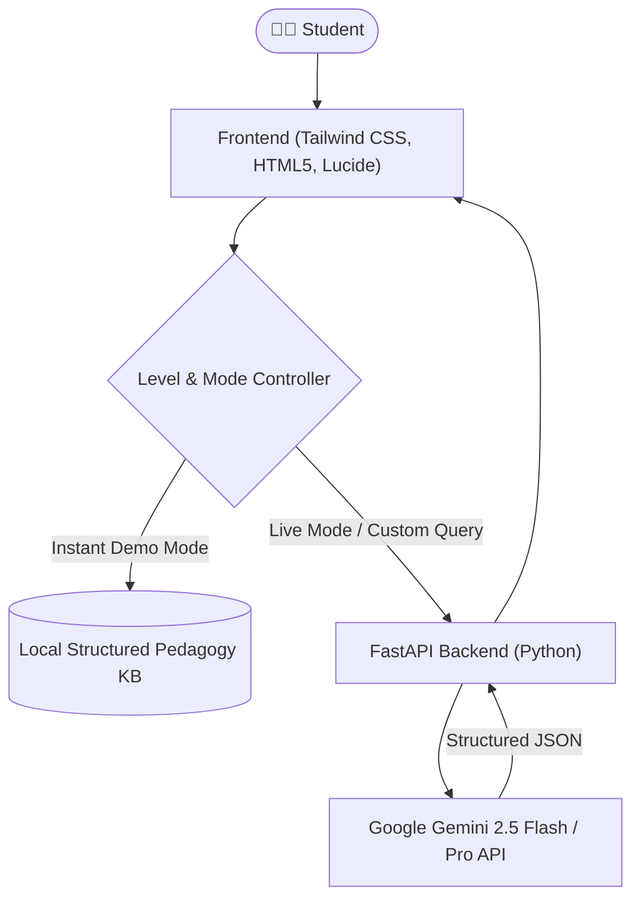

# edubuddy-ai
AI powered personal learning assistant thst makes academic topic easy to undersrand

# 🎓 EduBuddy — AI-Powered Student Learning Assistant
> **Problem Statement PS04**: Adaptive concept simplification, interactive active recall, and misconception diagnostic platform for students.

---

## 🚀 Instant 5-Second Demo (No Installation Required!)
You can test and demonstrate EduBuddy **immediately**:
1. Open [`frontend/index.html`](file:///C:/Users/massu/.gemini/antigravity/scratch/edubuddy/frontend/index.html) in any web browser (Chrome, Edge, Firefox).
2. The entire interactive learning platform is live with:
   - **Multi-Level Concept Simplifier** (ELI5 $\leftrightarrow$ High School $\leftrightarrow$ College $\leftrightarrow$ Exam Cheat Sheet)
   - **Active Recall Diagnostic Quiz** with dynamic misconception feedback
   - **3D Spaced Repetition Flashcards**
   - **Interactive Voice Tutor (Text-to-Speech)**
   - **Confetti celebrations** on quiz completion

---

## 🛠️ Architecture & Tech Stack (Option B)



- **Frontend**: Responsive Single Page App with Tailwind CSS, Lucide Icons, Canvas-Confetti, and Web Speech API.
- **Backend**: Python 3 + FastAPI with strict Pydantic schemas and CORS support.
- **AI Engine**: Google Gemini API (`gemini-2.5-flash`) with structured JSON schema constraints for zero-hallucination pedagogical outputs.

---

## 💻 Running the Python Backend (Optional)

If your machine has Python installed:
```bash
# 1. Navigate to the backend directory
cd backend

# 2. Install dependencies
pip install -r requirements.txt

# 3. Create your .env file
copy .env.example .env
# Add your GEMINI_API_KEY in .env

# 4. Start the FastAPI server
uvicorn main:app --reload --port 8000
```
Backend API documentation will be available at: `http://localhost:8000/docs`.

---

## 🏆 The 3-Minute Hackathon Demo Script (How to Pitch to Judges)

| Time | Slide / Screen Action | What to Say |
| :--- | :--- | :--- |
| **0:00 - 0:30** | Hook & Problem | *"Judges, every student has spent hours staring at dense textbook pages, feeling completely lost. The problem isn't that students aren't smart—it's that academic resources are one-size-fits-all. Meet **EduBuddy**, the adaptive AI learning assistant that matches each student's exact understanding level."* |
| **0:30 - 1:15** | Dynamic Simplification Demo | Click **Quantum Superposition** $\rightarrow$ Show **ELI5 Level** (Spinning Coin analogy).<br>*"Notice how EduBuddy replaces intimidating jargon with an intuitive mental model. Now, watch what happens when an engineering student needs depth: with one click, we switch to College Level—instantly unlocking Bloch sphere vectors, state formulas, and formal proofs."* |
| **1:15 - 2:00** | Active Recall & Diagnostic Demo | Scroll to the **Quiz Zone** $\rightarrow$ Click an **incorrect option intentionally**.<br>*"EduBuddy doesn't just grade right or wrong. Look at this: it diagnoses the student's exact misconception! It explains why they fell into that thinking trap and steers them back on track."*<br>Click the correct option $\rightarrow$ Confetti celebration! 🎉 |
| **2:00 - 2:30** | Spaced Repetition & Audio | Flip the 3D flashcards $\rightarrow$ Click **"Listen (TTS)"** to hear the audio tutor.<br>*"We cater to visual, audio, and active-recall learners in one unified interface."* |
| **2:30 - 3:00** | Impact & Q&A Wrap-up | *"EduBuddy bridges the gap between passive reading and true conceptual mastery. We're ready for your questions!"* |

---

## 📋 Evaluation Rubric Alignment

| Hackathon Criteria | How EduBuddy Hits It |
| :--- | :--- |
| **Innovation & Creativity** | Moves beyond basic chatbot replies by providing structured multi-level cognitive scaffolding and misconception analysis. |
| **Technical Implementation** | Clean decoupling of API schemas, prompt engineering with JSON enforcement, and responsive UI. |
| **User Experience (UI/UX)** | Intuitive level sliders, 3D flip flashcards, audio integration, and visual feedback. |
| **Practical Impact** | Directly solves student cognitive overload and textbook abandonment. |
